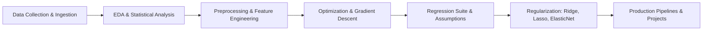

# 🤖 100 Days of Machine Learning

[](https://www.python.org/)
[](https://numpy.org/)
[](https://pandas.pydata.org/)
[](https://scikit-learn.org/)
[](https://jupyter.org/)

A structured, code-and-math-grounded journey through Machine Learning fundamentals, practical data science, and end-to-end projects. 

This repository emphasizes **learning from first principles**: deriving cost functions, understanding optimization geometry, implementing core algorithms from scratch using NumPy, and contrasting them with production-grade **Scikit-Learn** pipelines.

---

## 🧭 Roadmap & Completed Modules



---

## 📚 Notebook Directory & Key Learnings

### 1. 🌐 Data Collection & Ingestion
Mastering techniques to acquire, parse, and handle structured and unstructured real-world datasets.

| Topic | Notebook | Key Concepts |
|---|---|---|
| **API Data Ingestion** | [fetching_data_using_api.ipynb](Data%20Collection/fetching_data_using_api.ipynb) | REST APIs, HTTP requests, pagination, JSON parsing |
| **Web Scraping** | [web_scrapping.ipynb](Data%20Collection/web_scrapping.ipynb) | HTML parsing with `BeautifulSoup`, CSS selectors, structured data extraction |
| **Handling Messy CSVs** | [handling_csv.ipynb](Data%20Preprocessing/handling_csv.ipynb) | Custom delimiters, character encodings, headerless tables, bad lines |

---

### 2. 📊 Exploratory Data Analysis (EDA) & Analytics
Uncovering distributions, patterns, anomalies, and correlations before modeling.

| Topic | Notebook | Key Concepts |
|---|---|---|
| **Univariate Analysis** | [univariate_analysis.ipynb](Data%20Analysis/univariate_analysis.ipynb) | PDF, CDF, KDE, Histograms, Box plots, skewness, categorical counts |
| **Bivariate & Multivariate** | [bivariate.ipynb](Data%20Analysis/bivariate.ipynb) | Scatter plots, correlation matrices, cross-tabulation, pairplots |
| **Outlier Detection & Treatment** | [outliers.ipynb](Data%20Analysis/outliers.ipynb) | IQR proximity rule, Z-score thresholds, Trimming vs. Capping (Winsorization) |
| **Automated EDA Profiling** | [profiling.ipynb](Data%20Analysis/profiling.ipynb) | Rapid automated dataset diagnostics and reporting |
| **Sports Analytics (IPL)** | [IPL_Analysis.ipynb](pandas/IPL_Analysis.ipynb) & [deliveries_analysis.ipynb](pandas/deliveries_analysis.ipynb) | Multi-table joins, aggregations, season trends, match-level analytics |
| **Pandas End-to-End Workflow** | [end_to_end.ipynb](pandas/end_to_end.ipynb) | Advanced grouping, indexing, filtering, and data cleaning |

---

### 3. ⚙️ Preprocessing & Feature Engineering
Transforming raw data into robust, leakage-free representations suitable for machine learning models.

| Topic | Notebook | Key Concepts |
|---|---|---|
| **Feature Construction** | [feature_construction.ipynb](Data%20Preprocessing/feature_construction.ipynb) & [feature_engg.ipynb](feature%20eng/feature_engg.ipynb) | Domain-specific feature generation, interaction terms, feature splitting |
| **Categorical Encoding** | [one_hot_encoding.ipynb](feature%20eng/one_hot_encoding.ipynb) | One-Hot Encoding (OHE), handling dummy variable trap, frequency encoding |
| **Mathematical Transformations** | [Function_Transformer.ipynb](feature%20eng/Function_Transformer.ipynb) | Log transform, reciprocal, and power transformations for normal distributions |
| **Dimensionality Reduction (PCA)** | [PCA.ipynb](feature%20eng/PCA.ipynb) & [pca-demo-1.ipynb](feature%20eng/pca-demo-1.ipynb) | Covariance matrix, Eigenvalues/Eigenvectors, explained variance ratio |
| **Pipelines vs. Manual Workflow** | [titanic_with_pipelines.ipynb](feature%20eng/titanic_with_pipelines.ipynb) vs [titanic_wout_pipelines.ipynb](feature%20eng/titanic_wout_pipelines.ipynb) | Preventing data leakage, `ColumnTransformer`, unified fit/transform pipelines |
| **Model Inference with Pipelines** | [with_pipeline_pred.ipynb](Data%20Preprocessing/with_pipeline_pred.ipynb) | Exporting and predicting on unseen production records using saved pipelines |

---

### 4. ⚡ Optimization & Gradient Descent
Deep-dive into the mathematical engine powering modern machine learning.

| Topic | Notebook | Key Concepts |
|---|---|---|
| **Gradient Descent Intuition** | [gd_understanding.ipynb](Gradient%20Descent/gd_understanding.ipynb) & [understanding_gd_2.ipynb](Gradient%20Descent/understanding_gd_2.ipynb) | Loss landscapes, slope, step size, learning rate effect |
| **Manual Math Derivations** | [gd_calculation_from_scratch.ipynb](Gradient%20Descent/gd_calculation_from_scratch.ipynb) | Partial derivatives with respect to slope ($m$) and intercept ($b$) |
| **Batch Gradient Descent** | [Batch_GD.ipynb](Gradient%20Descent/Batch_GD.ipynb) | Full dataset epoch updates, vectorization, convergence behavior |
| **Stochastic Gradient Descent (SGD)** | [Stochastic_GD.ipynb](Gradient%20Descent/Stochastic_GD.ipynb) | Sample-by-sample noisy updates, escaping local minima, scaling to large data |
| **Mini-Batch Gradient Descent** | [MiniBatch_GD.ipynb](Gradient%20Descent/MiniBatch_GD.ipynb) | Balancing computational efficiency, vectorization, and variance reduction |

---

### 5. 📈 Regression Algorithms & Diagnostics
From simple lines to multi-dimensional hyperplanes and non-linear polynomial surfaces.

| Topic | Notebook | Key Concepts |
|---|---|---|
| **Simple Linear Regression** | [SimpleLinearRegression.ipynb](Regression%20Algorithms/Linear%20Regression/SimpleLinearRegression.ipynb) | Scikit-learn implementation, slope/intercept interpretation, plotting regression lines |
| **SLR from Scratch** | [SLR_scratch.ipynb](Regression%20Algorithms/Linear%20Regression/SLR_scratch.ipynb) | Closed-form Ordinary Least Squares (OLS) formula for $m$ and $b$ in pure Python/NumPy |
| **Multiple Linear Regression** | [multiple_linear_regression.ipynb](Regression%20Algorithms/Linear%20Regression/multiple_linear_regression.ipynb) | Multi-feature linear modeling with Scikit-learn |
| **MLR from Scratch (Matrix Form)** | [MLR_scratch_code.ipynb](Regression%20Algorithms/Linear%20Regression/MLR_scratch_code.ipynb) | Normal Equation derivation & vectorized NumPy implementation: $\beta = (X^T X)^{-1} X^T y$ |
| **Polynomial Regression** | [polynomial-regression.ipynb](Regression%20Algorithms/Polynomial%20Regression/polynomial-regression.ipynb) | Modeling non-linear relationships, degree selection, bias-variance tradeoff |
| **Regression Evaluation Metrics** | [regression_metrics.ipynb](Regression%20Algorithms/Regression%20Evaluation/regression_metrics.ipynb) | Mathematical and practical differences: MAE, MSE, RMSE, $R^2$, Adjusted $R^2$ |
| **Linear Regression Assumptions** | [linear-regression-assumptions.ipynb](Regression%20Algorithms/Regression%20Evaluation/linear-regression-assumptions.ipynb) | Linearity, Normality of residuals, Homoscedasticity, Multicollinearity & VIF |

---

### 6. 🛡️ Regularization (Shrinkage & Feature Selection)
Preventing overfitting and tackling multicollinearity through penalization techniques.

| Algorithm | Notebook | Key Concepts |
|---|---|---|
| **Ridge Regression (L2)** | [Ridge_Regularisation.ipynb](Regression%20Algorithms/Regularisation/Ridge%20Regression/Ridge_Regularisation.ipynb) | L2 weight shrinkage penalty ($\lambda \sum w_j^2$), reducing variance |
| **Ridge from Scratch (1D)** | [ridge-regression-from-scratch-m-and-b.ipynb](Regression%20Algorithms/Regularisation/Ridge%20Regression/ridge-regression-from-scratch-m-and-b.ipynb) | Analytical derivation and implementation of regularized slope and intercept |
| **Ridge from Scratch (N-Dim)** | [ridge-regression-from-scratch_for_N_dim.ipynb](Regression%20Algorithms/Regularisation/Ridge%20Regression/ridge-regression-from-scratch_for_N_dim.ipynb) | Matrix formulation: $W = (X^T X + \lambda I)^{-1} X^T y$ |
| **Ridge via Gradient Descent** | [ridge-regression-gradient-descent.ipynb](Regression%20Algorithms/Regularisation/Ridge%20Regression/ridge-regression-gradient-descent.ipynb) | Iterative optimization with penalty gradient updates |
| **Ridge Intuitions & Tradeoffs** | [ridge-regression-key-understandings.ipynb](Regression%20Algorithms/Regularisation/Ridge%20Regression/ridge-regression-key-understandings.ipynb) | Behavior under multicollinearity and varying alpha values |
| **Lasso Regression (L1)** | [lasso-regression-demo.ipynb](Regression%20Algorithms/Regularisation/lasso-regression-demo.ipynb) & [key points](Regression%20Algorithms/Regularisation/lasso-regression-key-points.ipynb) | L1 penalty ($\lambda \sum |w_j|$), automated feature selection |
| **Lasso Sparsity Proof** | [lasso_sparsity.ipynb](Regression%20Algorithms/Regularisation/lasso_sparsity.ipynb) | Geometric intuition: why diamond contours create exact zeros on axes |
| **ElasticNet Regression** | [elastic-net-regression.ipynb](Regression%20Algorithms/Regularisation/elastic-net-regression.ipynb) | Combining L1 and L2 penalties with `l1_ratio` to balance sparsity and grouping |

---

### 7. 🚀 End-to-End Projects

#### 🎬 [Movie Recommender System](M%26L%20Projects/Movie%20Recommendor%20System/movie_recommendor.ipynb)
- **Dataset:** TMDB 5000 Movies & Credits dataset.
- **Approach:** Content-Based Filtering using metadata tags (genres, keywords, cast, crew).
- **Core Techniques:** Text preprocessing, vectorization (`CountVectorizer`), and vector similarity calculation using **Cosine Similarity**.
- **Result:** Generates top $N$ closest movie recommendations based on textual distance in high-dimensional feature space.

---

## 📂 Repository Directory Structure

```text
100_days_ml/
├── Data Analysis/                  # EDA, distribution checks, outlier handling
├── Data Collection/                # APIs, web scraping scripts & notebooks
├── Data Preprocessing/             # CSV cleaning, feature creation, inference
├── feature eng/                    # OHE, FunctionTransformer, PCA, pipelines
├── Gradient Descent/               # Intuition, derivations, Batch, Mini-Batch, SGD
├── Regression Algorithms/
│   ├── Linear Regression/          # SLR & MLR (scratch OLS/matrix + sklearn)
│   ├── Polynomial Regression/      # Non-linear modeling
│   ├── Regression Evaluation/      # Metrics (MAE, MSE, RMSE, R²) & Assumptions
│   └── Regularisation/             # Ridge (scratch/N-D/GD), Lasso, ElasticNet
├── M&L Projects/
│   └── Movie Recommendor System/   # TMDB Content-Based Recommender
├── pandas/                         # Cricket analytics & data wrangling
└── models/                         # Serialized pipeline & model binaries (.pkl)
```

---

## 🛠️ Tech Stack & Tools

- **Programming Language:** Python 3.x
- **Scientific Computing & Data Manipulation:** NumPy, Pandas
- **Visualization:** Matplotlib, Seaborn
- **Machine Learning & Modeling:** Scikit-Learn
- **Data Scraping & APIs:** Requests, BeautifulSoup4
- **Interactive Computing:** Jupyter Notebook

---

## ⚡ Quick Start & Reproduction

```bash
# 1. Clone the repository
git clone https://github.com/suhavani23/100_days_of_ML.git
cd 100_days_of_ML

# 2. Create and activate a virtual environment (optional but recommended)
python -m venv venv
# Windows:
venv\Scripts\activate
# Mac/Linux:
source venv/bin/activate

# 3. Install core dependencies
pip install numpy pandas matplotlib seaborn scikit-learn beautifulsoup4 requests jupyter

# 4. Launch Jupyter Notebook
jupyter notebook
```

---

*Continuously updated as part of the #100DaysOfML challenge.* 🚀